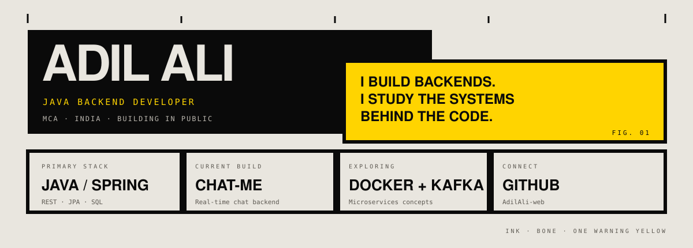

<picture>
  <source media="(prefers-color-scheme: dark)" srcset="./assets/profile-brutalist.svg">
  <source media="(prefers-color-scheme: light)" srcset="./assets/profile-brutalist.svg">
  
</picture>

[ GITHUB ↗ ](https://github.com/AdilAli-web) &nbsp; / &nbsp; [ LINKEDIN ↗ ](https://www.linkedin.com/in/adil-ali-0563341b3)

---

## 01 / POSITION

**I build backends. I study the systems behind the code.**

I'm an MCA student focused on Java backend engineering. My work and learning center on REST APIs, relational data, persistence, authentication, real-time communication, and the fundamentals behind distributed systems.

| FOCUS | CURRENT TOOLKIT |
|:--|:--|
| **LANGUAGE** | Java · SQL · C · JavaScript |
| **BACKEND** | Spring Boot · Spring Data JPA · Hibernate · REST APIs |
| **DATA** | MySQL · relational modelling · indexing |
| **REAL-TIME** | WebSockets · session handling |
| **SYSTEMS** | Docker · Kafka fundamentals · microservices concepts |
| **WORKFLOW** | Git · GitHub · Maven · Postman · IntelliJ IDEA |

## 02 / WORK IN PROGRESS

<table>
  <tr>
    <td width="50%" valign="top">
      <h3>01 — <a href="https://github.com/AdilAli-web/CHAT-ME">CHAT-ME</a></h3>
      
<strong>REAL-TIME CHAT BACKEND</strong>

      
A Java and Spring Boot project exploring account management, persistent messages, and real-time message delivery.

      <ul>
        <li>Spring Data JPA entities and repositories</li>
        <li>MySQL storage and message retrieval indexes</li>
        <li>WebSocket connection and delivery handling</li>
        <li>Spring Security / BCrypt foundations</li>
      </ul>
      
<code>JAVA</code> <code>SPRING BOOT</code> <code>MYSQL</code> <code>WEBSOCKET</code>

    </td>
    <td width="50%" valign="top">
      <h3>02 — BOOKMYSHOW BACKEND</h3>
      
<strong>SHOWS · SEATS · BOOKINGS</strong>

      
A backend project focused on movie-show booking workflows and relational application design.

      <ul>
        <li>Show, booking, and seat domain models</li>
        <li>Availability checks and persistence logic</li>
        <li>Spring Boot APIs and database relationships</li>
      </ul>
      
<code>JAVA</code> <code>SPRING BOOT</code> <code>JPA</code> <code>MYSQL</code>

    </td>
  </tr>
</table>

[ BROWSE ALL REPOSITORIES ↗](https://github.com/AdilAli-web?tab=repositories)

## 03 / THE TOOLBOX

## 04 / LEARNING LOG

- **JAVA CORE** — OOP, collections, generics, streams, exceptions, concurrency
- **BACKEND** — validation, authentication, transactions, JPA/Hibernate
- **DATABASES** — SQL, relationships, indexes, query performance
- **SYSTEMS** — Docker, Kafka fundamentals, microservices architecture
- **PROBLEM SOLVING** — arrays, hashing, two pointers, sliding window, complexity

## 05 / ACTIVITY

  <picture>
    <source media="(prefers-color-scheme: dark)" srcset="https://github-readme-stats.vercel.app/api?username=AdilAli-web&amp;show_icons=true&amp;hide_border=true&amp;bg_color=0d1117&amp;title_color=ffd400&amp;icon_color=ffd400&amp;text_color=e9e6df">
    <source media="(prefers-color-scheme: light)" srcset="https://github-readme-stats.vercel.app/api?username=AdilAli-web&amp;show_icons=true&amp;hide_border=true&amp;bg_color=e9e6df&amp;title_color=0a0a0a&amp;icon_color=5c5851&amp;text_color=0a0a0a">
    
  </picture>
  <picture>
    <source media="(prefers-color-scheme: dark)" srcset="https://github-readme-stats.vercel.app/api/top-langs/?username=AdilAli-web&amp;layout=compact&amp;hide_border=true&amp;bg_color=0d1117&amp;title_color=ffd400&amp;text_color=e9e6df">
    <source media="(prefers-color-scheme: light)" srcset="https://github-readme-stats.vercel.app/api/top-langs/?username=AdilAli-web&amp;layout=compact&amp;hide_border=true&amp;bg_color=e9e6df&amp;title_color=0a0a0a&amp;text_color=0a0a0a">
    
  </picture>

## 06 / CONTACT

**Adil Ali** · Java Backend Developer in the making

[GitHub — @AdilAli-web](https://github.com/AdilAli-web) &nbsp; / &nbsp; [LinkedIn](https://www.linkedin.com/in/adil-ali-0563341b3)

---

**BUILD / LEARN / REPEAT** &nbsp; — &nbsp; END OF FILE 001

