 

### ✦ JAVA BACKEND ENGINEERING · CONTINUOUSLY LEARNING ✦

*I like understanding what happens behind the API — from data and transactions to real-time communication.*

---

## ⚡ About

I'm an MCA student focused on **Java backend development**. I learn by building and debugging real projects, with an interest in API design, persistence, authentication, concurrency, and the infrastructure that supports backend services.

- 🔭 Building **CHAT-ME** and working on **BookMyShow Backend** workflows.
- 🧩 Practising **Java, SQL, Spring Boot, Spring Data JPA, and Hibernate**.
- 🚀 Exploring **Docker, Kafka fundamentals, and microservices concepts**.
- 🧠 Improving DSA and core Java knowledge alongside project work.

## 🚀 Featured projects

<table>
<tr>
<td width="50%" valign="top">

<h3>💬 CHAT-ME</h3>

A chat backend project exploring account management, persistent messages, and real-time communication.

<strong>Key areas</strong>
<ul>
<li>Spring Boot APIs and JPA persistence</li>
<li>MySQL data modelling and query design</li>
<li>WebSocket communication</li>
<li>Spring Security foundations</li>
</ul>

</td>
<td width="50%" valign="top">

<h3>🎟️ BookMyShow Backend</h3>

A backend learning project focused on movie shows, seat availability, and booking flows.

<strong>Key areas</strong>
<ul>
<li>Show, booking, and seat domain models</li>
<li>Availability checks and persistence logic</li>
<li>Entity relationships and transaction handling</li>
<li>Concurrency-aware seat selection</li>
</ul>

</td>
</tr>
</table>

<a href="https://github.com/AdilAli-web?tab=repositories">✦ Browse all repositories →</a>

---

## 🧩 Skills & technologies

<table>
<tr>
<td align="center" width="50%">

<strong>⚡ LANGUAGES</strong>  
 

</td>
<td align="center" width="50%">

<strong>🚀 BACKEND</strong>  
 

</td>
</tr>
<tr>
<td align="center" width="50%">

<strong>🗄️ DATA & MESSAGING</strong>  
 

</td>
<td align="center" width="50%">

<strong>🛠️ TOOLS & INFRASTRUCTURE</strong>  

</td>
</tr>
</table>

  
  

## 🧪 Currently sharpening

- **Java:** collections, streams, generics, exception handling, concurrency
- **Spring Boot:** validation, authentication, transactions, API design
- **Persistence:** entity relationships, indexes, query performance, Hibernate
- **Systems:** Docker, Kafka, and service communication fundamentals
- **Problem solving:** hashing, two pointers, sliding windows, complexity analysis

## 📈 GitHub activity

  
  

Java backend development · Projects in progress · Always learning

