<picture>
  <source media="(prefers-color-scheme: dark)" srcset="./assets/profile-aurora.svg">
  <source media="(prefers-color-scheme: light)" srcset="./assets/profile-aurora.svg">
  
</picture>

 

## About

I'm an MCA student focused on **Java backend development**. I like understanding how applications work beyond the endpoint: data modelling, transactions, authentication, real-time messaging, and the infrastructure around a service.

- Currently building **CHAT-ME** and developing **BookMyShow backend** workflows.
- Working with **Java, Spring Boot, Spring Data JPA, Hibernate, and MySQL**.
- Exploring **Docker, Apache Kafka, and microservices concepts**.
- Practising core Java and DSA while building projects.

## Featured work

<table>
  <tr>
    <td width="50%" valign="top">
      <a href="https://github.com/AdilAli-web/CHAT-ME"><strong>CHAT-ME ↗</strong></a>
        
      
      
A chat backend exploring account management, persistent messages, and real-time delivery.

      <ul>
        <li>Spring Data JPA entities and repositories</li>
        <li>MySQL persistence and message-query indexes</li>
        <li>WebSocket session handling</li>
        <li>Spring Security / BCrypt foundations</li>
      </ul>
      Java · Spring Boot · MySQL · WebSocket
    </td>
    <td width="50%" valign="top">
      <strong>BookMyShow Backend</strong>
        
      
      
A backend project exploring movie-show booking workflows and relational application design.

      <ul>
        <li>Show, booking, and seat domain models</li>
        <li>Availability and persistence logic</li>
        <li>Spring Boot APIs and database relationships</li>
      </ul>
      Java · Spring Boot · JPA/Hibernate · MySQL
    </td>
  </tr>
</table>

[Explore all repositories →](https://github.com/AdilAli-web?tab=repositories)

## Stack

| Area | Technologies |
|---|---|
| **Languages** | Java · SQL · C · JavaScript |
| **Backend** | Spring Boot · Spring Data JPA · Hibernate · REST APIs |
| **Data & realtime** | MySQL · WebSockets · database indexing |
| **Infrastructure** | Docker · Kafka fundamentals · microservices concepts |
| **Tools** | Git · GitHub · Maven · Postman · IntelliJ IDEA |

## Currently sharpening

- **Java:** OOP, collections, generics, streams, exceptions, concurrency
- **Backend engineering:** validation, authentication, transactions, JPA/Hibernate
- **Databases:** SQL, relationships, indexes, query performance
- **System fundamentals:** Docker, Kafka, microservices architecture
- **Problem solving:** arrays, hashing, two pointers, sliding window, complexity

## GitHub activity

  <picture>
    <source media="(prefers-color-scheme: dark)" srcset="https://github-readme-stats.vercel.app/api?username=AdilAli-web&show_icons=true&hide_border=true&bg_color=0d1117&title_color=67e8f9&icon_color=a78bfa&text_color=c9d1d9">
    <source media="(prefers-color-scheme: light)" srcset="https://github-readme-stats.vercel.app/api?username=AdilAli-web&show_icons=true&hide_border=true&bg_color=ffffff&title_color=0369a1&icon_color=0d9488&text_color=334155">
    
  </picture>
  <picture>
    <source media="(prefers-color-scheme: dark)" srcset="https://github-readme-stats.vercel.app/api/top-langs/?username=AdilAli-web&layout=compact&hide_border=true&bg_color=0d1117&title_color=67e8f9&text_color=c9d1d9">
    <source media="(prefers-color-scheme: light)" srcset="https://github-readme-stats.vercel.app/api/top-langs/?username=AdilAli-web&layout=compact&hide_border=true&bg_color=ffffff&title_color=0369a1&text_color=334155">
    
  </picture>

---

**Build thoughtfully. Learn continuously. Ship useful things.**

[GitHub](https://github.com/AdilAli-web) &nbsp; · &nbsp; [LinkedIn](https://www.linkedin.com/in/adil-ali-0563341b3)

