<picture>
  <source media="(prefers-color-scheme: dark)" srcset="./assets/profile-modern.svg">
  <source media="(prefers-color-scheme: light)" srcset="./assets/profile-modern.svg">
  
</picture>

 

## About me

I'm an MCA student focused on **Java backend development**. I enjoy building APIs and understanding the engineering behind them — data modelling, transactions, authentication, concurrency, and reliable persistence.

- 🔭 Building **CHAT-ME** and exploring booking workflows with **BookMyShow Backend**.
- 🌱 Learning more about **Spring Boot, JPA/Hibernate, Docker, Kafka, and system design**.
- 🧠 Practising Java, SQL, and data structures and algorithms.
- 🎯 Goal: build backend services that are understandable, testable, and reliable.

## Featured projects

<table>
  <tr>
    <td width="50%" valign="top">
      <h3>💬 <a href="https://github.com/AdilAli-web/CHAT-ME">CHAT-ME</a></h3>
      
      
A chat backend focused on user accounts, message persistence, and real-time communication.

      
<strong>Exploring</strong>

      <ul>
        <li>Spring Boot APIs and JPA persistence</li>
        <li>MySQL data modelling and query design</li>
        <li>WebSocket communication</li>
        <li>Spring Security and password hashing foundations</li>
      </ul>
      
<code>Java</code> <code>Spring Boot</code> <code>MySQL</code> <code>WebSocket</code>

    </td>
    <td width="50%" valign="top">
      <h3>🎟️ BookMyShow Backend</h3>
      
      
A backend learning project for movie shows, seat availability, and booking operations.

      
<strong>Exploring</strong>

      <ul>
        <li>Show, booking, and seat domain models</li>
        <li>Availability checks and persistence logic</li>
        <li>Database relationships and transactional flows</li>
        <li>Concurrency-aware seat selection</li>
      </ul>
      
<code>Java</code> <code>Spring Boot</code> <code>JPA/Hibernate</code> <code>MySQL</code>

    </td>
  </tr>
</table>

<a href="https://github.com/AdilAli-web?tab=repositories">View all repositories →</a>

## Tech stack

| Focus | Tools and technologies |
|---|---|
| **Languages** | Java · SQL · C · JavaScript |
| **Backend** | Spring Boot · Spring Data JPA · Hibernate · REST APIs |
| **Databases & messaging** | MySQL · WebSockets · Kafka fundamentals |
| **Infrastructure** | Docker · microservices concepts |
| **Workflow** | Git · GitHub · Maven · Postman · IntelliJ IDEA |

## What I'm working on

- **Java:** collections, generics, streams, exceptions, and concurrency
- **Spring Boot:** validation, authentication, transactions, and API design
- **Persistence:** entity relationships, indexes, query performance, and Hibernate
- **System fundamentals:** Docker, Kafka, and service communication
- **Problem solving:** arrays, hashing, two pointers, sliding windows, and complexity

## GitHub at a glance

  <picture>
    <source media="(prefers-color-scheme: dark)" srcset="https://github-readme-stats.vercel.app/api?username=AdilAli-web&show_icons=true&hide_border=true&bg_color=0d1117&title_color=67e8f9&icon_color=a78bfa&text_color=c9d1d9">
    <source media="(prefers-color-scheme: light)" srcset="https://github-readme-stats.vercel.app/api?username=AdilAli-web&show_icons=true&hide_border=true&bg_color=ffffff&title_color=0369a1&icon_color=0d9488&text_color=334155">
    
  </picture>
  <picture>
    <source media="(prefers-color-scheme: dark)" srcset="https://github-readme-stats.vercel.app/api/top-langs/?username=AdilAli-web&layout=compact&hide_border=true&bg_color=0d1117&title_color=67e8f9&text_color=c9d1d9">
    <source media="(prefers-color-scheme: light)" srcset="https://github-readme-stats.vercel.app/api/top-langs/?username=AdilAli-web&layout=compact&hide_border=true&bg_color=ffffff&title_color=0369a1&text_color=334155">
    
  </picture>

---

*Build thoughtfully. Learn continuously. Ship useful things.*

<a href="https://github.com/AdilAli-web">GitHub</a> · <a href="https://www.linkedin.com/in/adil-ali-0563341b3">LinkedIn</a>

