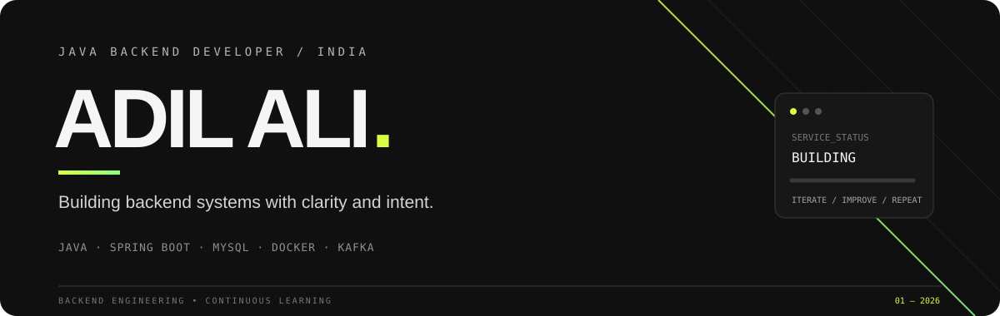

 

<a href="https://github.com/AdilAli-web?tab=repositories">PROJECTS ↗</a>
&nbsp;&nbsp; / &nbsp;&nbsp;
<a href="https://www.linkedin.com/in/adil-ali-0563341b3">LINKEDIN ↗</a>

---

### PROFILE

MCA student focused on **Java backend engineering**. I build projects to understand what happens behind an API: persistence, transactions, authentication, concurrency, and service design.

Currently focused on **Spring Boot**, **JPA/Hibernate**, **MySQL**, and the fundamentals of **Docker** and **Kafka**.

---

### SELECTED WORK

<table>
<tr>
<td width="50%" valign="top">

#### 01 / CHAT-ME

A chat backend project exploring account management, persistent messages, and real-time communication.

**AREAS OF WORK**
- Spring Boot APIs and JPA persistence
- MySQL data modelling and query design
- WebSocket communication
- Spring Security foundations

**JAVA · SPRING BOOT · MYSQL · WEBSOCKET**

</td>
<td width="50%" valign="top">

#### 02 / BOOKMYSHOW BACKEND

A backend learning project focused on movie shows, seat availability, and booking flows.

**AREAS OF WORK**
- Show, booking, and seat domain models
- Availability and persistence logic
- Entity relationships and transactions
- Concurrency-aware seat selection

**JAVA · SPRING BOOT · JPA · MYSQL**

</td>
</tr>
</table>

---

### TOOLKIT

| DOMAIN | CURRENT TOOLKIT |
|:--|:--|
| **LANGUAGES** | Java · SQL · C · JavaScript |
| **BACKEND** | Spring Boot · Spring Data JPA · Hibernate · REST APIs |
| **DATA & MESSAGING** | MySQL · WebSockets · Kafka fundamentals |
| **INFRASTRUCTURE** | Docker · Microservices concepts |
| **DEVELOPER TOOLS** | Git · GitHub · Maven · Postman · IntelliJ IDEA |

### CURRENTLY SHARPENING

- Java collections, streams, generics, and concurrency
- Spring validation, authentication, transactions, and API design
- SQL performance, indexes, and Hibernate relationships
- Docker, Kafka, and distributed-system fundamentals
- DSA: hashing, two pointers, sliding windows, and complexity

---

### GITHUB ACTIVITY

  
  

**BUILD WITH INTENT. LEARN BY SHIPPING.**

Java backend development · Projects in progress · Always improving

